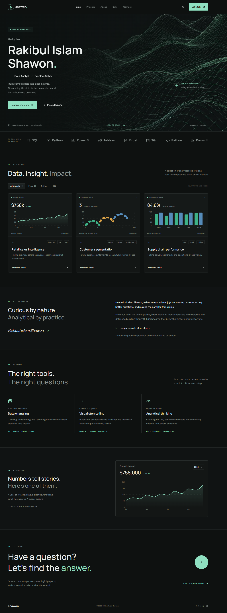

# Rakibul Islam Shawon — Data Analyst Portfolio

A responsive, single-page portfolio showcasing illustrative data-analysis projects, skills, and contact information. The portfolio is a public static site: visitors see the same content, and no sign-in is required.

> **Sample content:** The projects, metrics, résumé/profile text, and biography in this repository are illustrative portfolio content. They should not be read as verified work history, client results, or credentials.

## Features

- Responsive page with Home, Projects, About, Skills, Data Lab, and Contact sections
- Scroll-aware navigation and smooth section scrolling
- Light and dark themes
- Project cards with category filters, charts, and case-study dialogs
- Animated technology strip and interactive chart and card effects
- Downloadable résumé PDF at `src/assets/Rakibul-Islam-Shawon-Profile.pdf`
- Contact form that downloads an inquiry draft locally; it does not send or store messages
- Reduced-motion support for visitors who request less animation

## Content and configuration

The portfolio can be viewed and built without visitor accounts or an authentication flow. Avoid committing private credentials.
